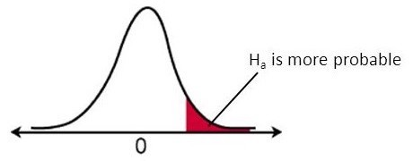
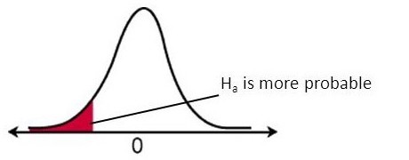
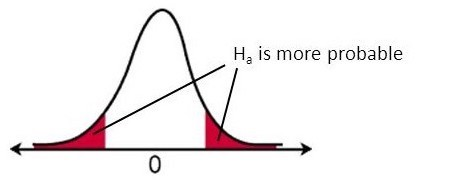
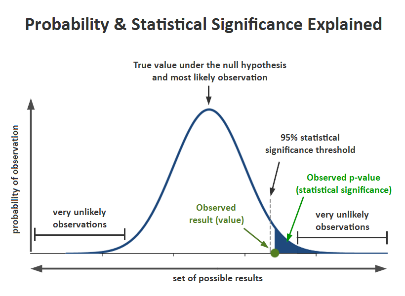

```{r setup, include=FALSE}
library(tidyverse)
knitr::opts_chunk$set(comment = NA)
```

# Statistical Framework

## General data modeling framework

::: {.r-fit-text}
- You have some data $\{x_1, \dots, x_n\}$ that you presume have been sampled **independently** from their corresponding random variables $\{X_1, \dots, X_n\}$;
- You formulate a simple hypothesis $H_0$, called *null* hypothesis, about the distribution from which this data were sampled;
- You want to confront this hypothesis against an *alternative* hypothesis $H_a$ using your **finite** amount of data;
- You use a *test statistic* $T(X_1, \dots, X_n)$ that depends on the sample (and thus that you can calculate anytime you observe a sample) and of which you know (an approximation of) the distribution when you assume that your null hypothesis is true; it is called the **null distribution** of the test statistic $T$;
- You compute the value $t_0$ of this test statistic with your observed data;
- You strongly reject $H_0$ if $t_0$ falls on the tails of the null distribution of $T$; **or**,
- You lack evidence to reject $H_0$ if $t_0$ ends up in the central part of the null distribution of $T$.
- **Warning:** It is straightforward from this setup to understand that the problem is not symmetric in the hypotheses. Indeed, the procedure relies on what happens when $H_0$ is true but does not depend on $H_a$.
:::

# Test Statistic

## Theoretical aspects

::: {.r-fit-text}
You design a **test statistic** $T(X_1, \dots, X_n)$ for the purpose of performing this test which must satisfy at least the first three of the following four properties:

- It evaluates to real values;
- You have all the required knowledge to compute its value once you observe the data;
- **If** $H_0$ is true, then small values of the statistic should comfort you with the idea that $H_0$ is a reasonable assumption, while larger values of the statistic should generate suspicion about $H_0$ **in favor** of the alternative hypothesis $H_a$;
- \[*optional*\] **If** $H_0$ is true, then it can be very helpful to have access to the (asymptotic) distribution of the test statistic under *classical* assumptions (such as normality).
:::

## Example: Test on the mean

::: {.r-fit-text}
Suppose you have a sample of $n$ *i.i.d.* random variables $X_1, \dots, X_n \sim \mathcal{N}(\mu, \sigma^2)$ and you know the value of $\sigma^2$. We want to test whether the mean $\mu$ of the distribution is equal to some pre-specified value $\mu_0$. We can therefore use $H_0: \mu = \mu_0$ vs. $H_a: \mu \ne \mu_0$. At this point, a good candidate test statistic to look at for performing this test is: $$ T(X_1, \dots, X_n) := \sqrt{n} \frac{\overline X - \mu_0}{\sigma}, \quad \mbox{with} \quad \overline X := \frac{1}{n} \sum_{i=1}^n X_i. $$

- It evaluates to real values;
- You have all the required knowledge to compute its value once you observe the data ($\overline x$);
- The sample mean $\overline X$ is an unbiased estimator of the true unknown mean $\mu$; so, if $H_0$ is true, then $\overline X$ will produce values that are close to $\mu_0$; hence, small values of $T$ will comfort you with the idea that $H_0$ is a reasonable assumption, while larger values, both positive or negative, of the statistic should generate suspicion about $H_0$ **in favor** of the alternative hypothesis $H_a$;
- If you assume normality and independence of the sample, then $T \sim \mathcal{N}(0, 1)$ under $H_0$.
:::

## Distribution of the test statistic under $H_0$

::: {.r-fit-text}
- **Parametric testing.** If you designed your test statistic carefully, you might have access to its theoretical distribution when $H_0$ is true under distributional assumptions about the data. This is called **parametric** hypothesis testing.

- **Asymptotic testing.** If it is not the case, you can often derive the theoretical distribution of the statistic under the null hypothesis asymptotically, i.e. assuming that you have a large sample ($n \gg 1$); this is called **asymptotic** hypothesis testing.

- **Bootstrap testing.** If you are in a large sample size regime but still cannot have access to the theoretical distribution of your test statistic, you can approach this distribution using bootstrapping; this is called **bootstrap** hypothesis testing.

- **Permutation testing.** If you are in a low sample size regime, then you can approach the distribution of the test statistic using permutations; this is called **permutation** hypothesis testing.
:::

## Two-sided vs. one-sided hypothesis tests

::: {.r-fit-text}
Depending on what you put into the alternative hypothesis $H_a$, larger values of the test statistic that raise suspicion regarding the validity of $H_0$ might mean:

- larger values only on the right tail of the null distribution of $T$;
- larger values only on the left tail of the null distribution of $T$;
- larger values on both tails.

In the first two cases, we say that the test is **one-sided**. In the latter case, we say that the test is **two-sided** because we interpret large values in both tails as suspicious.
:::

## Example: Test on the mean (*continued*)

::: {.r-fit-text}
Suppose you have a sample of $n$ *i.i.d.* random variables $X_1, \dots, X_n \sim \mathcal{N}(\mu, \sigma^2)$ and you know the value of $\sigma^2$. We want to test whether the mean $\mu$ of the distribution is equal to some pre-specified value $\mu_0$. As we have seen, a good candidate test statistic to look at for performing this test is:

$$ T(X_1, \dots, X_n) := \sqrt{n} \frac{\overline X - \mu_0}{\sigma}, \quad \mbox{with} \quad \overline X := \frac{1}{n} \sum_{i=1}^n X_i. $$

Now, using this test statistic, we might be interested in performing three different tests:

1.  $H_0: \mu = \mu_0$ vs. $H_a: \mu > \mu_0$;
2.  $H_0: \mu = \mu_0$ vs. $H_a: \mu < \mu_0$;
3.  $H_0: \mu = \mu_0$ vs. $H_a: \mu \ne \mu_0$.
:::

## $H_0: \mu = \mu_0$ vs. $H_a: \mu > \mu_0$

::: {.r-fit-text}
$$ T(X_1, \dots, X_n) := \sqrt{n} \frac{\overline X - \mu_0}{\sigma} $$ Remember that we must look at large values of $T$ that raise suspicion **in favor** of $H_a$.

```{r test-right-tail, echo=FALSE, fig.align='center'}

```

- $\overline X$ is an unbiased estimator of the true mean.

- Large negative values of $T$ that happen when the true mean is far less than $\mu_0$ **does not** raise suspicion **in favor** of $H_a$.

- Large positive values of $T$ that happen when the true mean is far more than $\mu_0$ **does** raise suspicion **in favor** of $H_a$.

- **Conclusion:** we are interested only in the **right** tail of the null distribution of $T$ to find evidence to reject $H_0$.
:::

## $H_0: \mu = \mu_0$ vs. $H_a: \mu < \mu_0$

::: {.r-fit-text}
$$ T(X_1, \dots, X_n) := \sqrt{n} \frac{\overline X - \mu_0}{\sigma} $$ Remember that we must look at large values of $T$ that raise suspicion **in favor** of $H_a$.

```{r test-left-tail, echo=FALSE, fig.align='center'}

```

- $\overline X$ is an unbiased estimator of the true mean.

- Large negative values of $T$ that happen when the true mean is far more than $\mu_0$ **does not** raise suspicion **in favor** of $H_a$.

- Large positive values of $T$ that happen when the true mean is far less than $\mu_0$ **does** raise suspicion **in favor** of $H_a$.

- **Conclusion:** we are interested only in the **left** tail of the null distribution of $T$ to find evidence to reject $H_0$.
:::

## $H_0: \mu = \mu_0$ vs. $H_a: \mu \ne \mu_0$

::: {.r-fit-text}
$$ T(X_1, \dots, X_n) := \sqrt{n} \frac{\overline X - \mu_0}{\sigma} $$ Remember that we must look at large values of $T$ that raise suspicion **in favor** of $H_a$.

```{r test-two-tail, echo=FALSE, fig.align='center'}

```

- $\overline X$ is an unbiased estimator of the true mean.

- Large negative values of $T$ that happen when the true mean is far more than $\mu_0$ **does** raise suspicion **in favor** of $H_a$.

- Large positive values of $T$ that happen when the true mean is far less than $\mu_0$ **does** raise suspicion **in favor** of $H_a$.

- **Conclusion:** we are interested in both the **left** and the **right** tails of the null distribution of $T$ to find evidence to reject $H_0$.
:::

# Making a decision

## Type I and Type II errors

::: {.r-fit-text}
So we are now at a point where we know which tail(s) which we should look at and we now need to make a decision as to what *large* means. In other words, above which **threshold** on all possible values of my test statistic should I consider that I can reject $H_0$.

- Notice that you are going to take this decision based on the null distribution.
- When you decide to reject or not, you might make an error:

```{r error-table, echo=FALSE, message=FALSE}
library(tidyverse)
library(kableExtra)
tibble(
  Decision = c("Do not reject \\(H_0\\)", "Reject \\(H_0\\)"), 
  `\\(H_0\\) is true` = c("Well done", "Type I error"), 
  `\\(H_a\\) is true` = c("Type II error", "Well done")
) %>% 
  kbl(format = "html", align = 'c', escape = FALSE) %>%
  kable_styling(position = "center")
```

- The only error rate you can control is the type I error rate because it is a probability computed **assuming that the null hypothesis is true**, which is exactly the situation we put ourselves in for making the decision (i.e. looking at the tails of the null distribution of $T$).
:::

## Significance level

::: {.r-fit-text}
- At this point, you can decide that you do not want to make more than a certain amount of type I errors. So you want to force that $\mathbb{P}_{H_0}(\mbox{reject } H_0) \le \alpha$, for some upper bound threshold $\alpha$ on the probability of type I errors. This threshold is called **significance level** of the test and is often denoted by the greek letter $\alpha$.

- Let us now translate what this rule implies for the right-tail alternative case. The event "$\mbox{reject } H_0$" translates in this case into $T > x$ for some $x$ value of the test statistic $T$. Hence, the rule becomes: $$ \mathbb{P}_{H_0}(T > x) \le \alpha \\ \Leftrightarrow 1 - \mathbb{P}_{H_0}(T \le x) \le \alpha \\ \Leftrightarrow 1 - F_T^{\left(H_0\right)}(x) \le \alpha \\ \Leftrightarrow F_T^{\left(H_0\right)}(x) \ge 1 - \alpha $$ verified for all $x \ge q_{1-\alpha}$, where $q_{1-\alpha}$ is the quantile of order $1-\alpha$ of the null distribution of $T$.
:::

## Significance level (*continued*)

::: {.r-fit-text}
**Decision-making rule**:

- We reject $H_0$ if the value $t_0$ of the test statistic computed on the observed sample is greater than the quantile of order $1-\alpha$ of the null distribution of $T$;
- We decide that we lack evidence to reject $H_0$ if the value $t_0$ of the test statistic calculated on the observed sample is smaller than the quantile of order $1-\alpha$ of the null distribution of $T$.
- This decision-making rule guarantees that the probability of making a type I error is upper-bounded by the significance level $\alpha$.
:::

## p-value {.flexbox .vcenter}

::: {.r-fit-text}
- **Definition.** The **p-value** is a scalar value between $0$ and $1$ that measures *what was the probability, assuming that the null hypothesis* $H_0$ is true, of observing the data we did observe, or data even more in favor of the alternative hypothesis.
- **Mathematical expression.** If $t_0$ is the value of the test statistic computed from the observed sample, then:

  - $p = \mathbb{P}_{H_0}(T > t_0)$ for right-tail hypothesis tests (e.g. $H_a: \mu > \mu_0$ when testing the mean);
  - $p = \mathbb{P}_{H_0}(T < t_0)$ for left-tail hypothesis tests (e.g. $H_a: \mu < \mu_0$ when testing the mean);
  - $p = 2 \min\left( \mathbb{P}_{H_0} \left( T > t_0 \right), \mathbb{P}_{H_0} \left( T < t_0 \right) \right)$ for two-tail hypothesis tests (e.g. $H_a: \mu \ne \mu_0$ when testing the mean).

- **Interpretation.** If the $p$-value is very small, it means that

  - *either* we observed a miracle,
  - *or* the null hypothesis might be wrong.

- **Decision-making rule.** We can show that rejecting the null hypothesis when $p \le \alpha$ also produces a decision-making rule that guarantees a probability of type I error at most $\alpha$.
:::

## Decision-Making: Summary (right-tail scenario)

```{r decision-summary}
#| echo: false
#| fig-align: center
#| out-width: 65%

```

## Statistical power of a test

::: {.r-fit-text}
- **Definition.** It is the probability of correctly rejecting the null hypothesis, *i.e.* to reject it when the alternative is in fact correct. It is often denoted by $\mu$. In terms of events, it is defined by: $$ \mu := \mathbb{P}_{H_a}(\mbox{Reject } H_0). $$
- **Usage.** The statistical power of a test is an important aspect of the test because:

  - it is an important performance indicator to compare different testing procedures (observe that there is not a unique statistic to perform a given test);
  - it is often used in clinical trials or other types of trials (e.g. crash tests) to calibrate the number of observations required to achieve a given statistical power.
  
- **Remarks.**

  - The statistical power $\mu$ is equal to $1 - \beta$, where $\beta$ is the greek letter often used to designate the probability of type II errors, $\beta := \mathbb{P}_{H_a}(\mbox{Do not reject } H_0)$.
  - Power calculations are difficult because it requires to put ourselves under $H_a$, which is often of the form $\mu > \mu_0$ or $\mu < \mu_0$ or $\mu \ne \mu_0$. In other words, you often lack information to compute probabilities assuming that the alternative hypothesis is true. You have to assess how the power changes as you explore different alternatives.
:::

# Compliance testing

::: {.r-fit-text}
Compliance testing aims at determining whether a process, product, or service complies with the requirements of a specification, technical standard, contract, or regulation.
:::

## Testing the mean

::: {.r-fit-text}
- **Model.** Let $(X_1, \dots, X_n)$ be $n$ *i.i.d.* random variables that follow a normal distribution $\mathcal{N}(\mu, \sigma^2)$.
- **Hypotheses.** $$ H_0: \mu = \mu_0 \quad \mbox{vs.} \quad H_a: \mu \ne \mu_0 \quad \mbox{or} \quad H_a: \mu > \mu_0 \quad \mbox{or} \quad H_a: \mu < \mu_0. $$
- **Test Statistic.** $$ Z_n = \sqrt{n} \frac{\overline X_n - \mu_0}{\sigma}. $$
- **Problem.** Under the null hypothesis, I do not have complete knowledge to compute the test statistic because I do not know the value of $\sigma$.
:::

## Testing the mean with known variance

::: {.r-fit-text}
- **Problem solved.** I now have complete knowledge to compute the test statistic.
- **Null distribution.** The null distribution is $$ Z_n \stackrel{H_0}{\sim} \mathcal{N}(0, 1). $$
- **R function.** None
:::

## Testing the mean with unknown variance

::: {.r-fit-text}
- **Problem solved.** I plug in the empirical standard deviation instead of $\sigma$ in the definition of the test statistic.
- **Test Statistic.** $$ T_n = \frac{\overline X_n - \mu_0}{\sqrt{\frac{S_{n-1}^2}{n}}}, \quad \mbox{with} \quad S_{n-1}^2 := \frac{1}{n-1} \sum_{i = 1}^n (X_i - \overline X)^2. $$
- **Null distribution.** $$ T_n \stackrel{H_0}{\sim} \mathcal{S}tudent(n-1). $$
- **R function.** [t.test()](https://stat.ethz.ch/R-manual/R-devel/library/stats/html/t.test.html)
:::

## Testing the variance

::: {.r-fit-text}
- **Assumptions.** Let $(X_1, \dots, X_n)$ be $n$ *i.i.d.* random variables that follow a normal distribution $\mathcal{N}(\mu, \sigma^2)$.
- **Hypotheses.** $$ H_0: \sigma^2 = \sigma_0^2 \quad \mbox{vs.} \quad H_a: \sigma^2 \ne \sigma_0^2 \quad \mbox{or} \quad H_a: \sigma^2 > \sigma_0^2 \quad \mbox{or} \quad H_a: \sigma^2 < \sigma_0^2. $$
- **Test Statistic.** $$ U_n = \sum_{i = 1}^n \frac{(X_i - \mu)^2}{\sigma_0^2}. $$
- **Problem.** Under the null hypothesis, I do not have complete knowledge to compute the test statistic because I do not know the value of $\mu$.
:::

## Testing the variance with known mean

::: {.r-fit-text}
- **Problem solved.** I now have complete knowledge to compute the test statistic.
- **Null distribution.** The null distribution is $$ U_n \stackrel{H_0}{\sim} \chi^2(n). $$
- **R function.** None.
:::

## Testing the variance with unknown mean

::: {.r-fit-text}
- **Problem solved.** I plug in the empirical mean instead of $\mu$ in the definition of the test statistic.
- **Test Statistic.** $$ U_{n-1} = \sum_{i = 1}^n \frac{\left( X_i - \overline X_n \right)^2}{\sigma_0^2}. $$
- **Null distribution.** $$ U_{n-1} \stackrel{H_0}{\sim} \chi^2(n-1). $$
- **R function.** None.
:::

## Testing a proportion

::: {.r-fit-text}
Here we want to test whether the proportion $p$ of individuals in a given
population who have a feature of interest is equal to a pre-specified rate.

- **Model.** Let $(X_1, \dots, X_n)$ be $n$ *i.i.d.* random variables that follow a Bernoulli distribution $\mathcal{B}e(p)$. The interpretation is that $X_i$ measures if individual $i$ possesses the characteristic of which we want to know the proportion or not.
- **Hypotheses.** $$ H_0: p = p_0 \quad \mbox{vs.} \quad H_a: p \ne p_0 \quad \mbox{or} \quad H_a: p > p_0 \quad \mbox{or} \quad H_a: p < p_0. $$
- **Test Statistic.** $$ B_n = \sum_{i=1}^n X_i $$
- **Null distribution.** $$ B_n \sim \mathcal{B}inom(n,p_0) $$
- **R function.** [binom.test()](https://stat.ethz.ch/R-manual/R-devel/library/stats/html/binom.test.html)
:::

# Two-Sample Testing

::: {.r-fit-text}
Hypothesis tests for comparing the distributions that generated two independent samples.
:::

## Testing for variance differences

::: {.r-fit-text}
- **Model.** Let $(X_1, \dots, X_{n_x})$ be $n_X$ *i.i.d.* random variables that follow a normal distribution $\mathcal{N}(\mu_X, \sigma_X^2)$ and $(Y_1, \dots, Y_{n_Y})$ be $n_Y$ *i.i.d.* random variables that follow a normal distribution $\mathcal{N}(\mu_Y, \sigma_Y^2)$. Assume furthermore that the two samples are statistically independent.
- **Hypotheses.** $$ H_0: \sigma_X^2 = \sigma_Y^2 \quad \mbox{vs.} \quad H_a: \sigma_X^2 \ne \sigma_Y^2 \quad \mbox{or} \quad H_a: \sigma_X^2 > \sigma_Y^2 \quad \mbox{or} \quad H_a: \sigma_X^2 < \sigma_Y^2 $$
- **Test Statistic.** $$ V_n = \frac{S_X^2}{S_Y^2}, \quad \mbox{with} \quad S_X^2 = \frac{1}{n_X - 1} \sum_{i = 1}^{n_X} (X_i - \overline X_n)^2 \quad \mbox{and} \quad S_Y^2 = \frac{1}{n_Y - 1} \sum_{i = 1}^{n_Y} (Y_i - \overline Y_n)^2 $$
- **Null distribution.** $$ V_n \stackrel{H_0}{\sim} \mathcal{F}isher(n_X - 1, n_Y - 1) $$
- **R function.** [var.test()](https://stat.ethz.ch/R-manual/R-devel/library/stats/html/var.test.html)
- **Validity.** Relies on the normality assumption and independence within and between samples.
:::

## Testing for mean differences

::: {.r-fit-text}
- **Model.** Let $(X_1, \dots, X_{n_x})$ be $n_X$ *i.i.d.* random variables that follow a normal distribution $\mathcal{N}(\mu_X, \sigma_X^2)$ and $(Y_1, \dots, Y_{n_Y})$ be $n_Y$ *i.i.d.* random variables that follow a normal distribution $\mathcal{N}(\mu_Y, \sigma_Y^2)$. Assume furthermore that the two samples are statistically independent.
- **Hypotheses.** $$ H_0: \mu_X = \mu_Y \quad \mbox{vs.} \quad H_a: \mu_X \ne \mu_Y \quad \mbox{or} \quad H_a: \mu_X > \mu_Y \quad \mbox{or} \quad H_a: \mu_X < \mu_Y $$
- **R function.** [t.test()](https://stat.ethz.ch/R-manual/R-devel/library/stats/html/t.test.html)
- **Validity.** Relies on the normality assumption and independence within and between samples.
:::

## Testing for mean differences when variances are equal

::: {.r-fit-text}
- **Test Statistic.** Let $\delta = \mu_X - \mu_Y$ be the mean difference and $\delta_0$ be the assumed mean difference under $H_0$. Then, 
$$
T_n = \frac{\left( \overline X_n - \overline Y_n \right) - \delta_0}{\sqrt{S_\mathrm{pooled}^2 \left( \frac{1}{n_X} + \frac{1}{n_Y} \right)}} \mbox{ with } S_\mathrm{pooled}^2 = \frac{(n_X - 1) S_X^2 + (n_Y - 1) S_Y^2}{n_X + n_Y - 2}
$$
- **Null distribution.**
$$
T_n \stackrel{H_0}{\sim} \mathcal{S}tudent(n_X + n_Y - 2)
$$
:::

## Testing for mean differences when variances are not equal

::: {.r-fit-text}
- **Test Statistic.** 
$$
T_n = \frac{\left( \overline X_n - \overline Y_n \right) - \delta_0}{\sqrt{\frac{S_X^2}{n_X} + \frac{S_Y^2}{n_Y}}}
$$
- **Null distribution.** 
$$
T_n \stackrel{H_0}{\sim} \mathcal{S}tudent(m) \mbox{ with } m = \frac{\left( \frac{S_X^2}{n_X} + \frac{S_Y^2}{n_Y} \right)^2}{\frac{\left( \frac{S_X^2}{n_X} \right)^2}{n_X-1} + \frac{\left( \frac{S_Y^2}{n_Y} \right)^2}{n_Y-1}}.
$$
:::

# Adequacy testing

::: {.r-fit-text}
Adequacy tests aim at determining if the distribution of the observations is coherent with a given probability distribution.
:::

## Shapiro-Wilk test

::: {.r-fit-text}
- **Hypotheses.** $$ H_0: (X_1, \dots, X_n) \stackrel{i.i.d.}{\sim} \mathcal{N}(\mu, \sigma^2) \quad \mbox{vs.} \quad H_a: (X_1, \dots, X_n) \not\sim \mathcal{N}(\mu, \sigma^2). $$
- **Test Statistic.** 
$$
T_n = {\left(\sum_{i=1}^n a_i X_{(i)}\right)^2 \over \sum_{i=1}^n (X_i-\overline{X}_n)^2} 
$$
where $X_{(i)}$ is the order statistic for observation $i$, $\overline X_n$ the sample mean and $(a_1, \dots, a_n)$ are weights computed from the first two moments of the order statistics of standard normal variables.
- **Null distribution.** $$ T \stackrel{H_0}{\sim} \mathcal{W}ilks(n). $$
- **R function.** [shapiro.test()](https://stat.ethz.ch/R-manual/R-devel/library/stats/html/shapiro.test.html)
- **Validity.** The sample size should meet $3 \le n \le 5000$. The Wilks distribution is approximated except for $n=3$.
:::

## Kolmogorov-Smirnov test

::: {.r-fit-text}
- **Hypotheses.** $$ H_0: (X_1, \dots, X_n) \stackrel{i.i.d.}{\sim} F_0 \quad \mbox{vs.} \quad H_a: (X_1, \dots, X_n) \not\sim F_0. $$
- **Test Statistic.** 
$$
T_n = \sup_{x \in \mathbb R} | F_n(x) - F(x)|
$$ 
where $F_n$ is the cumulative distribution function and $F$ is the cumulative distribution function of the law under testing.
- **Null distribution.** $$ \sqrt{n} T \xrightarrow{\mathcal{L}} \sup_{x \in \mathbb R} | B(F(x))|, $$ where $B$ is the Brownian bridge.
- **R function.** [ks.test()](https://stat.ethz.ch/R-manual/R-devel/library/stats/html/ks.test.html)
- **Validity.** Asymptotic.
:::

## $\chi^2$ test of adequacy for a single categorical variable

::: {.r-fit-text}
- **Model.** We group observations in classes and we compare the observed frequencies of these classes to the corresponding theoretical frequencies as given by the hypothesized law $F_0$.
- **Hypotheses.** $H_0: (X_1, \dots, X_n) \stackrel{i.i.d.}{\sim} F_0 \quad \mbox{vs.} \quad H_a: (X_1, \dots, X_n) \not\sim F_0$.
- **Test Statistic.** 
$$
U_n = n\sum_{i=1}^k\frac{(f_i-f_{0i})^2}{f_{0i}},
$$ 
where $n$ is the total number of observations, $k$ the number of classes, $f_i = n_i / n$ and $f_{i0}$ the theoretical frequency of class $i$, *i.e.* the probability that the random variable ends up in class $i$.
- **Null distribution.** $$ U_n \xrightarrow{\mathcal{L}} \chi^2_{k - 1 - \ell}, \mbox{ where } \ell \mbox{ is the number of estimated parameters for } F_0.$$
- **R function.** [chisq.test()](https://stat.ethz.ch/R-manual/R-devel/library/stats/html/chisq.test.html)
- **Validity.** Requires large class frequencies. Typically, $n_i \ge 5$.
:::

## $\chi ^2$ test of independence between two categorical variables

::: {.r-fit-text}
- **Model.** Let $X = (Y, Z) = ((Y_1, Z_1), \dots, (Y_n, Z_n))$ be a bivariate sample of $n$ *i.i.d.* pairs of categorical random variables. Let $\nu$ be the law of $(Y_1, Z_1)$, $\mu$ the law of $Y_1$ and $\lambda$ the law of $Z_1$. Let $\{y_1, \dots, y_s\}$ be the set of possible values for $Y_1$ and $\{z_1, \dots, z_r\}$ the set of possible values for $Z_1$. For $\ell \in \{1, \dots, s\}$ et $h \in \{1, \dots, r\}$, let 
$$ N_{\ell,\cdot} = \left| \left\{ i  \in \{1, \dots, n\}; Y_i = y_\ell \right\} \right|,\quad N_{\cdot, h} = \left| \left\{ i  \in \{1, \dots, n\}; Z_i = z_h \right\} \right|, \\ N_{\ell,h} = \left| \left\{(i \in \{1, \dots, n\}; Y_i = y_\ell, Z_i = z_h \right\} \right|.
$$
- **Hypotheses.** $H_0: \nu = \mu \otimes \lambda \quad \mbox{vs.} \quad H_a: \nu \ne \mu \otimes \lambda$.
- **Test statistic.** $$ U_n = n  \sum_{\ell = 1}^s \sum_{h = 1}^r \frac{ \left( \frac{N_{\ell, h}}{n}  -  \frac{N_{\ell, \cdot}}{n} \frac{N_{\cdot, h}}{n} \right)^2 }{ \frac{N_{\ell, \cdot}}{n} \frac{N_{\cdot, h}}{n} }. $$
- **Null distribution.** $U_n \xrightarrow{\mathcal{L}} \chi^2 \left( (s-1)(r-1) \right)$.
- **R function.** [chisq.test()](https://stat.ethz.ch/R-manual/R-devel/library/stats/html/chisq.test.html)
- **Validity.** Asymptotic. Often, $n \gg 30$ and $N_{\ell, h} \gg 5$, for each pair $(\ell, h)$.
:::
