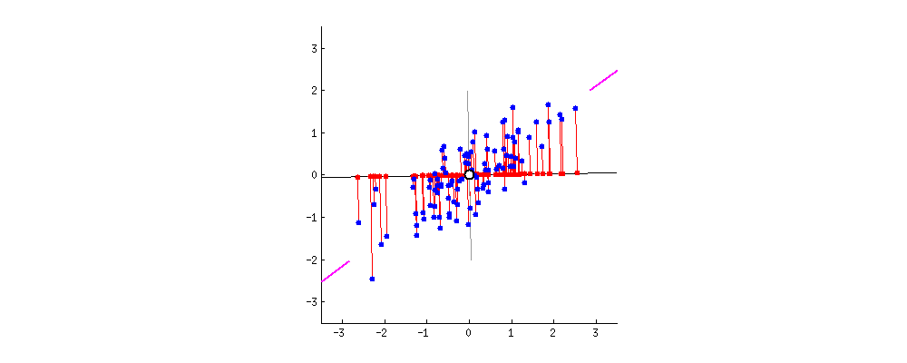
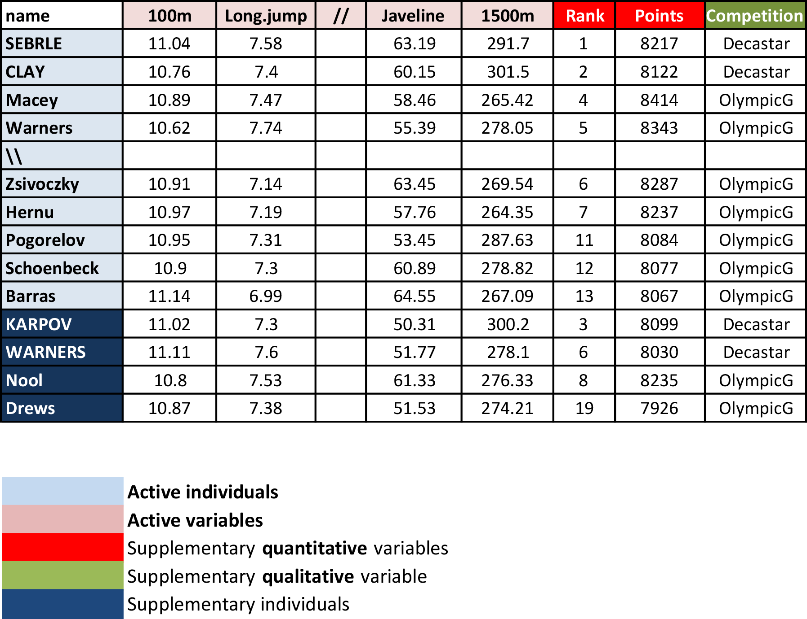

```{r setup, include=FALSE, message=FALSE}
knitr::opts_chunk$set(echo = FALSE)
knitr::opts_chunk$set(comment = NA)
library(tidyverse)
library(DT)
library(FactoMineR)
library(factoextra)
library(corrplot)
library(viridis)
data(decathlon)
html_table <- function(x, offset = 5) {
  DT::datatable(
    data = x, 
    rownames = TRUE, 
    options = list(
      scrollX = TRUE, 
      searching = FALSE, 
      scrollY = "290px",
      scrollCollapse = TRUE,
      lengthMenu = c(0, 5, 10, 15) + offset
    )
  )
}
```

# Overview

## Dimensionality reduction {.build}

**Problem.** Many variables make data hard to read and models risky (multicollinearity, overfitting, broken assumptions).

**Question.** "How do I keep most of the information with only a few variables?"

<div style="color: green; text-align: center;">
<font style="font-size: larger;">
$\Longrightarrow$ Reduce the dimension of the feature space.
</font>
</div>

Fewer relationships to juggle, and a much smaller risk of overfitting.

## PCA {.build}

**What?** A *feature-extraction* technique: it **combines** the input variables so you can drop the least important ones while keeping the most valuable parts of all. A bonus: the new variables are mutually **independent**.

**How?** It finds the directions, the **principal components**, in which the data vary most, assuming direction with the largest variance is the most *important*.

**When?** You cannot hand-pick variables to drop; you want independent inputs; you can live with less interpretable variables.

## Principle

<!--  -->


- PC1 accounts for the largest possible variance: the direction where projections (red dots) spread out most.
- PC2 is uncorrelated with PC1 and maximizes the *remaining* variance.
- And so on.

## Mathematical formalism

<div style="float: left; width: 50%;">
**Context.**

$\mathbf{X}_1, \dots, \mathbf{X}_n$ a sample of $n$ *i.i.d.* random vectors in $\mathbb{R}^p$; $\mathbb{X}$ the $n \times p$ data matrix; $\Sigma$ the covariance of the $\mathbf{X}_i$'s.

**1st PC.**

Search a linear projection $\mathbf{a} \in \mathbb{R}^p$ of maximal variance: $\mathbb{X}\mathbf{a}$, with per-coordinate variance $\mathrm{Var}([\mathbb{X}\mathbf{a}]_i) = \mathbf{a}^\top \Sigma \mathbf{a}$.
</div>

<div style="float: left; width: 50%;">
> - A constraint is needed, as the maximum does not exist over all of $\mathbb{R}^p$: impose $\| \mathbf{a} \| = 1$.
> - Use the sample covariance $S$ (unbiased for $\Sigma$) and solve $\max_{\| \mathbf{a} \| = 1} \mathbf{a}^\top S \mathbf{a}$.
> - Solution: an eigenvector of $S$ for the largest eigenvalue; the Lagrangian gives $S\mathbf{a} = \lambda \mathbf{a}$.
</div>

## R Packages {.build}

### Principal component computation

- `prcomp()` / `princomp()` from base **stats**;
- `PCA()` from [**FactoMineR**](https://factominer.free.fr);
- `dudi.pca()` from [**ade4**](https://pbil.univ-lyon1.fr/ade4/home.php?lang=eng).

### Recommendation

Use `FactoMineR::PCA()`.

### Extraction and visualization

The **factoextra** package.

## Case Study

**Decathlon data.** Athletes' performance during two events (Decastar, OlympicG); $41$ athletes described by $13$ variables.

```{r decathlon-data}
html_table(decathlon)
```

## Objectives {.build}

Run a PCA on all athletes to:

- **Study individuals.** Are some athletes close (similar results)? Establish *profiles*, oppose one group to another.
- **Study variables.** Summarize the correlation matrix and look for *synthetic* variables; can one number summarize an athlete's performance?
- **Link both.** Characterize each group of athletes by variables.

## PCA Terminology

<div style="float: left; width: 55%;">
```{r pca-terminology, out.width="90%"}

```
</div>

<div style="float: right; width: 45%;">
**Individuals.** *Active* ones build the PCA; *supplementary* ones get coordinates predicted from it.

**Variables.** *Active* ones build the PCA; *supplementary* ones are predicted too, either

- *Continuous* (cols 11, 12): rank and points;
- *Qualitative* (col 13): the meeting (Olympic Game / Decastar), used to color individuals by group.
</div>

## Data standardization {.build}

### Why it matters

PCA maximizes *variance*, so units bias it: a variable in centimeters swamps one in meters, whatever their intrinsic variability.

<div style="color: red; text-align: center;">
<font style="font-size: larger;">
$\Longrightarrow$ We need to scale the variables prior to PCA!
</font>
</div>

### A common solution: standardization

$$ x_{ij} \leftarrow \frac{x_{ij} - \overline{x}_j}{\sqrt{\frac{1}{n-1} \sum_{\ell=1}^n (x_{\ell j} - \overline{x}_j)^2}} $$

<div style="color: green; text-align: center;">
<font style="font-size: larger;">
$\Longrightarrow$ `PCA()` in [**FactoMineR**](http://factominer.free.fr) standardizes automatically.
</font>
</div>

## `PCA()` Syntax

```{r pca-syntax, eval=FALSE, echo=TRUE}
PCA(
  # a data frame with n rows (individuals) and p columns (numeric variables)
  X = , 
  
  # number of dimensions kept in the results (by default 5)
  ncp = , 
  
  # a vector indicating the indexes of the supplementary individuals
  ind.sup = , 
  
  # a vector indicating the indexes of the quantitative supplementary variables
  quanti.sup = ,
  
  # a vector indicating the indexes of the categorical supplementary variables
  quali.sup = , 
  
  # boolean, if TRUE (default) a graph is displayed
  graph = 
)
```

## Running `PCA()`

```{r pca-cmd, echo=TRUE, eval=FALSE}
PCA(X = decathlon[, 1:10], graph = FALSE)
```

```{r pca-run}
res_pca <- PCA(
  X = decathlon[, 1:10], 
  graph = FALSE
)
print(res_pca)
```

## Visualization and Interpretation {.build}

### The **factoextra** package

Whatever engine you used (`prcomp()`, `PCA()`, `dudi.pca()`, `epPCA()`), **factoextra** extracts and visualizes the results uniformly.

### Useful functions

- `get_eigenvalue()`: eigenvalues / variances of the components;
- `fviz_screeplot()`: eigenvalues & proportion of explained variance;
- `get_pca_ind()` / `get_pca_var()`: results for individuals / variables;
- `fviz_pca_ind()` / `fviz_pca_var()`: plots for individuals / variables;
- `fviz_pca_biplot()`: biplot of both.

# Choice of the reduced dimension

## Eigenvalues / Variances

<div style="color: green;">
<font style="font-size: larger;">
Eigenvalues measure the amount of variation retained by each principal component.
</font>
</div>

```{r eig, echo=TRUE}
eig_val <- get_eigenvalue(res_pca)
html_table(eig_val)
```

## Choosing the appropriate number of PCs {.build}

Eigenvalues drive how many PCs to keep.

<div style="float: left; width: 45%;">
**Guidelines.**

- An eigenvalue $> 1$ means a PC accounts for more variance than a single standardized variable (a common cutoff when data are standardized);
- Balance a small number of PCs (good reduction) against total explained variance;
- Look for interesting patterns in the first few PCs.
</div>

<div style="float:right; width: 55%;">
**Graphical tool.**

```{r screeplot-plot, out.width="90%"}
fviz_screeplot(res_pca, addlabels = TRUE)
```

```{r screeplot-code, echo=TRUE, eval=FALSE}
fviz_screeplot(res_pca, addlabels = TRUE)
```
</div>

# Analysis of the variables

## Variable Information in PCA {.build}

### Variable information extraction

```{r pca-var, echo=TRUE}
var_info <- get_pca_var(res_pca)
```

### Components

- `var_info$coord`: coordinates of the variables;
- `var_info$cos2`: quality of representation, `var.cos2 = var.coord * var.coord`;
- `var_info$contrib`: contribution to each PC, `(var.cos2 * 100) / (sum cos2 of the component)`.

### Usage

- How well do the PCs *represent* each variable?
- Describe each PC by its most contributing variables.

## `$coord`: Correlation variables & components

```{r pca-var-coord}
html_table(var_info$coord, offset = 10)
```

<div style="color: green; text-align: center;">
Property: column norms are 1 (eigenvectors).  
Consequence: each coordinate lies in $[-1,1]$.
</div>

# Contribution of PCs to variables

## `fviz_pca_var()`: Correlation circle

```{r pca-corrcirc, echo=TRUE, fig.align='center'}
fviz_pca_var(res_pca, col.var = "black")
```

## `$cos2`: Quality of representation

```{r pca-var-cos2}
html_table(var_info$cos2, offset = 10)
```

<div style="color: green; text-align: center;">
**Positive** or **negative** strong correlations of a PC to a variable mean the PC represents it well.  
**Squared** correlations therefore measure representation quality.
</div>

## `$cos2`: Graphical tool 1

```{r pca-var-cos2-plot1, fig.align='center', echo=TRUE}
corrplot::corrplot(var_info$cos2, is.corr = FALSE)
```

## `$cos2`: Graphical tool 2

```{r pca-var-cos2-plot2, fig.align='center', echo=TRUE}
# Total cos2 of variables on Dim.1 and Dim.2
factoextra::fviz_cos2(res_pca, choice = "var", axes = 1:2)
```

## `$cos2`: Summary {.build}

<div style="float: left; width: 40%;">
- High `cos2` means the variable is well represented by that PC;
- Low `cos2` means it is poorly represented;
- Near the circle: **very well** represented by the first two PCs;
- Near the center: **not well** represented.
</div>

<div style="float: right; width: 60%;">
```{r pca-var-plot-res, fig.align='center', out.width="100%"}
factoextra::fviz_pca_var(
  X = res_pca, 
  col.var = "cos2",
  gradient.cols = viridis::viridis(3),
  repel = TRUE
)
```
</div>

<div style="float: left; width: 100%;">
```{r pca-var-plot-code, eval=FALSE, echo=TRUE}
fviz_pca_var(X = res_pca, col.var = "cos2", gradient.cols = viridis(3), repel = TRUE)
```
</div>

# Contribution of variables to PCs

## `$contrib`: Important variables

```{r pca-var-contrib}
html_table(var_info$contrib, offset = 9)
```

<div style="color: green;">
- Most important: variables correlating with `Dim.1` and `Dim.2`;
- Variables correlating with no PC (or only the last ones) can be removed.
</div>

## `$contrib`: Graphical tool 1

```{r pca-var-contrib-plot1, fig.align='center', echo=TRUE}
corrplot::corrplot(var_info$contrib, is.corr = FALSE)
```

## `$contrib`: Graphical tool 2

<div style="float: left; width: 50%;">
```{r pca-var-contrib-plot2-pc1, fig.align='center', echo=TRUE, out.width="99%"}
# Contributions of variables to PC1
factoextra::fviz_contrib(
  X = res_pca, 
  choice = "var", 
  axes = 1, 
  top = 10
)
```
</div>

<div style="float: right; width: 50%;">
```{r pca-var-contrib-plot2-pc2, fig.align='center', echo=TRUE, out.width="99%"}
# Contributions of variables to PC2
factoextra::fviz_contrib(
  X = res_pca, 
  choice = "var", 
  axes = 2, 
  top = 10
)
```
</div>

## `$contrib`: Summary

```{r pca-var-contrib-plot, fig.align='center', fig.height=4, echo=TRUE}
factoextra::fviz_pca_var(
  X = res_pca, 
  col.var = "contrib",
  gradient.cols = viridis::viridis(3),
  repel = TRUE
)
```

## Component description

```{r pca-var-dimdesc, echo=TRUE}
res_pca_var_desc <- FactoMineR::dimdesc(res = res_pca, axes = c(1, 2), proba = 0.05)
```

<div style="float: left; width: 50%; text-align: center;">
**Description of PC1**
```{r pca-var-desc-pc1, fig.align='center', out.width="95%"}
html_table(res_pca_var_desc$Dim.1$quanti, offset = 10)
```
</div>

<div style="float: right; width: 50%; text-align: center;">
**Description of PC2**
```{r pca-var-desc-pc2, fig.align='center', out.width="95%"}
html_table(res_pca_var_desc$Dim.2$quanti, offset = 10)
```
</div>

# Analysis of the individuals

## The reduced space

### Individual information extraction

```{r pca-ind, echo=TRUE}
ind_info <- get_pca_ind(res_pca)
```

### Components

- `ind_info$coord`: coordinates of the individuals;
- `ind_info$cos2`: quality of representation, `ind.cos2 = ind.coord * ind.coord`;
- `ind_info$contrib`: contribution of individuals, `(ind.cos2 * 100) / (sum cos2 of the component)`.

### Usage

- The reduced space eases pattern spotting, if it represents them well;
- Similar individuals are grouped together on the plot.

## First factorial plane & quality

```{r res-pca-ind-cos2, echo=TRUE, fig.align='center', fig.height=4, warning=FALSE}
factoextra::fviz_pca_ind(
  X = res_pca, 
  col.ind = "cos2", 
  gradient.cols = viridis::viridis(3),
  repel = TRUE # Avoid text overlapping (slow if many points)
)
```

## First factorial plane & contribution

```{r res-pca-ind-contrib, echo=TRUE, fig.align='center'}
# Total contribution on PC1 and PC2
factoextra::fviz_contrib(res_pca, choice = "ind", axes = 1:2)
```

## First factorial plane colored by groups

```{r res-pca-competition-code, eval=FALSE, echo=TRUE}
factoextra::fviz_pca_ind(
  X = res_pca,
  col.ind = decathlon$competition[1:23], # color by groups
  palette = viridis::viridis(3),
  addEllipses = TRUE, # Concentration ellipses
  legend.title = "Competition"
)
```

<div style="float: left; width: 42%;">
- Shows whether a factorial plane *discriminates* individuals by a feature;
- Here Olympics score positively on PC1, Decastar negatively;
- But the ellipses overlap significantly.
</div>

<div style="float: right; width: 58%;">
```{r res-pca-competition-plot, fig.align='center', echo=FALSE, out.width="95%"}
factoextra::fviz_pca_ind(
  X = res_pca, 
  col.ind = decathlon$Competition, # color by groups
  palette = viridis::viridis(3),
  addEllipses = TRUE, # Concentration ellipses
  legend.title = "Competition"
)
```
</div>

# Combined variable and individual analysis

## Biplot

```{r res-pca-biplot-code, echo=TRUE, eval=FALSE}
fviz_pca_biplot(res_pca, repel = TRUE,
                col.var = "#2E9FDF", col.ind = "#696969")
```

<div style="float: left; width: 42%;">
- Only useful with few variables & individuals, else unreadable;
- Individuals and variables are not on the same scale: read *directions*, not absolute positions;
- An individual on the same side as a variable has a high value for it; opposite side, a low value.
</div>

<div style="float: right; width: 58%;">
```{r res-pca-biplot-plot, fig.align='center', echo=FALSE, out.width="95%"}
factoextra::fviz_pca_biplot(
  X = res_pca, 
  repel = TRUE,
  col.var = "#2E9FDF", # Variables color
  col.ind = "#696969"  # Individuals color
)
```
</div>

## Interpretation {.build}

- The first two dimensions resume 50% of total inertia (total variance);
- `100m` correlates negatively with `long.jump`: a short time goes with a big jump;
- Axis 1 opposes athletes **good everywhere** (Karpov, Olympic) to those **bad everywhere** (Bourguignon, Decastar);
- Axis 2 opposes **strong** (`Discus`, `Shot.put`) to **weak** athletes;
- Strength is not much correlated with speed.

<div style="color: green; text-align: center;">
<font style="font-size: larger;">
$\Longrightarrow$ Four profiles: fast+strong (Sebrle), slow (Casarsa), fast but weak (Warners), slow and weak (Lorenzo).
</font>
</div>

## Your turn

- Download the lab file and related data sets from the course website in a folder on your computer.
- Open the file `12-PCA-Exercises.qmd` and perform the PCA analyses for the proposed data sets.

## References

- <https://towardsdatascience.com/a-one-stop-shop-for-principal-component-analysis-5582fb7e0a9c>
- <http://www.sthda.com/english/articles/31-principal-component-methods-in-r-practical-guide/112-pca-principal-component-analysis-essentials/>
- <https://builtin.com/data-science/step-step-explanation-principal-component-analysis>
- <https://royalsocietypublishing.org/doi/pdf/10.1098/rsta.2015.0202>
- <http://factominer.free.fr/factomethods/principal-components-analysis.html>
